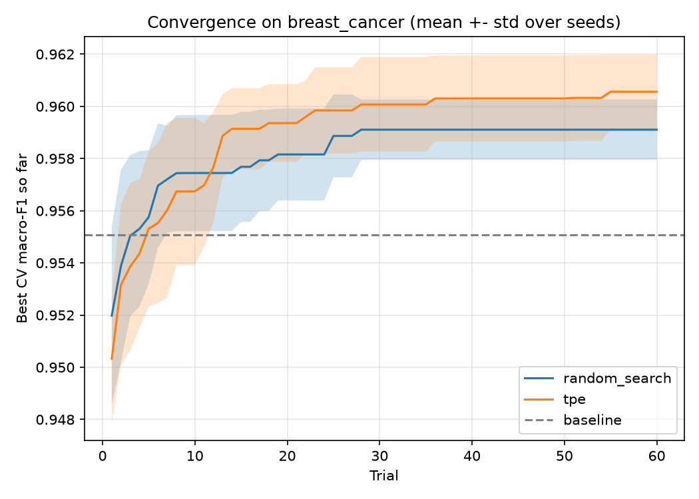
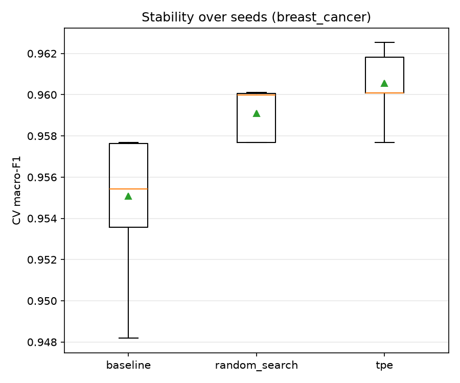
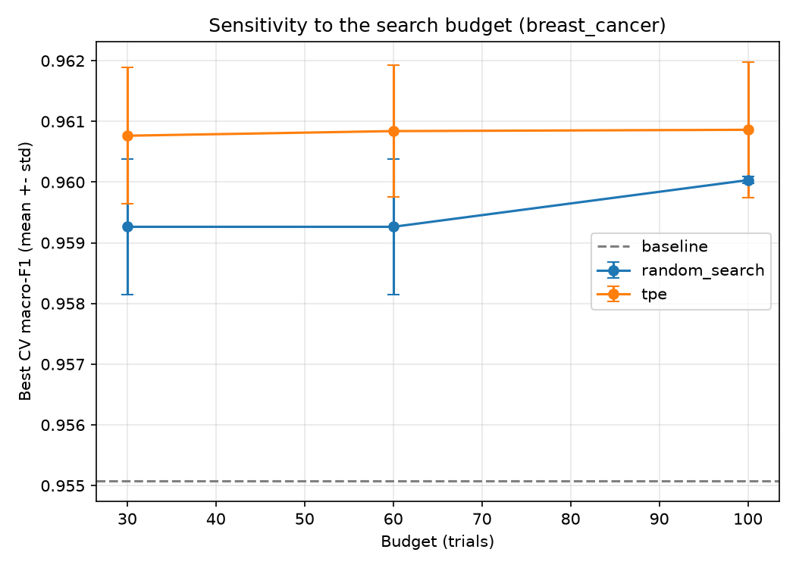
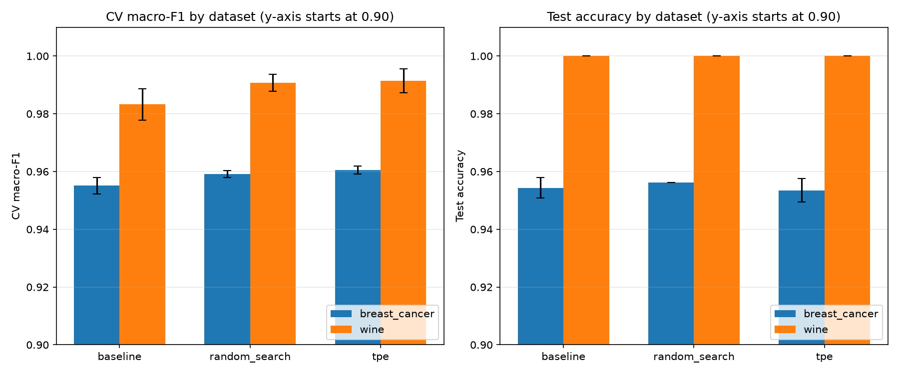

# Hyperparameter Optimization for Random Forest: Baseline vs Random Search vs TPE (Optuna)

A reproducible, fair-comparison study of hyperparameter optimization (HPO) for a Random Forest classifier on two public benchmark datasets. Coursework for *Introduction to Optimization* (Van Lang University, Faculty of Information Technology, AI major).

<details>
<summary><b>🇻🇳 Tóm tắt tiếng Việt</b></summary>

Đồ án mô hình hóa việc chọn siêu tham số của Random Forest thành bài toán tối ưu hộp đen: biến quyết định là bộ siêu tham số `x`, hàm mục tiêu là macro-F1 trung bình qua 5-fold cross-validation, ngân sách là số lần đánh giá cố định. Ba phương pháp được so sánh công bằng (cùng dữ liệu, cùng fold, cùng ngân sách, nhiều seed): **Baseline** (cấu hình mặc định), **Random Search** và **TPE / Bayesian Optimization** (Optuna). Tập test được khóa, chỉ dùng một lần ở bước đánh giá cuối. Thực nghiệm trên `breast_cancer` (chính) và `wine` (đánh giá tổng quát hóa), kèm phân tích độ nhạy theo ngân sách. Chạy lại toàn bộ bằng một lệnh: `python src/run_all.py`. Báo cáo đầy đủ nằm trong thư mục [`report/`](report/).

</details>

## 1. Problem

Choosing hyperparameters by hand is slow and unreliable. Given a fixed evaluation budget, **which search strategy finds better Random Forest configurations, and how much of that gain survives on unseen data?**

## 2. Formulation

| Element | Definition |
|---|---|
| Decision variables **x** | `n_estimators` ∈ [50, 500] (int), `max_depth` ∈ [3, 30] (int), `min_samples_split` ∈ [2, 20] (int), `max_features` ∈ {`sqrt`, `log2`, `None`} |
| Objective **f(x)** | mean 5-fold stratified CV **macro-F1** on the training set (maximise) |
| Constraints / budget | **x** inside the search space; exactly **N = 60** evaluations per method (30/60/100 in the sensitivity study) |
| Decision | recommended method and configuration under a given budget (see Results) |

$$x^* = \arg\max_{x \in \Omega} \; \mathrm{CV\text{-}F1}(x)$$

## 3. Methods

| Method | Description |
|---|---|
| **Baseline** | scikit-learn `RandomForestClassifier` with default hyperparameters (1 configuration, no search) |
| **Random Search** | N configurations sampled uniformly from the search space |
| **TPE** (Bayesian optimization) | Tree-structured Parzen Estimator via [Optuna](https://optuna.org): models good/bad regions of the space from past trials and samples where improvement is likely |

## 4. Experimental protocol (fair comparison)

- Same dataset, preprocessing (none: Random Forest is scale-invariant), 80/20 stratified train/test split (`random_state=42`) and the same CV folds for every method.
- Same evaluation budget for Random Search and TPE; baseline is a single configuration.
- Stochastic methods repeated over **seeds 0–9** (main experiment) and reported as mean ± std, never as a best run. Full trial history is stored for convergence plots.
- **The test set is locked**: it is never used in the objective or for any choice. After tuning, the best configuration of each (method, seed) is re-fitted on the whole training set and scored **once** on the test set (`src/evaluate_test.py`).

## 5. Datasets

| Dataset | Samples | Features | Classes | Test size | Source |
|---|---|---|---|---|---|
| Breast Cancer Wisconsin (Diagnostic) – main | 569 | 30 | 2 | 114 | UCI ML Repository, bundled in scikit-learn (`load_breast_cancer`) |
| Wine – generalisation study | 178 | 13 | 3 | 36 | UCI ML Repository, bundled in scikit-learn (`load_wine`) |

Both are public benchmarks shipped with scikit-learn, so no data is committed and there are no licensing or privacy concerns. Please cite the original sources (check the exact BibTeX with the *Cite* button on each UCI page):

- Wolberg, W., Mangasarian, O., Street, N., & Street, W. *Breast Cancer Wisconsin (Diagnostic)*. UCI Machine Learning Repository. https://doi.org/10.24432/C5DW2B
- Aeberhard, S., & Forina, M. *Wine*. UCI Machine Learning Repository. https://doi.org/10.24432/C5PC7J

## 6. Results

<!-- RESULTS:START -->
_No results yet - run `python src/run_all.py`._
<!-- RESULTS:END -->

Figures (generated by `src/analyze.py`, `src/analyze_sensitivity.py`, `src/compare_scalability.py`):

| Convergence (breast_cancer) | Stability over seeds (breast_cancer) |
|---|---|
|  |  |

| Sensitivity to the budget | Two datasets side by side |
|---|---|
|  |  |

### Key findings

<!-- FINDINGS:START -->
_To be written after the final run (see `results/` for the numbers)._
<!-- FINDINGS:END -->

## 7. How to run

Requires Python ≥ 3.10 (the reported results were produced with Python 3.14; exact library versions are stored in `results/<dataset>/run_meta.json`).

```bash
git clone https://github.com/<your-username>/rf-hyperparameter-optimization.git
cd rf-hyperparameter-optimization
python -m venv .venv
# Windows: .venv\Scripts\activate      Linux/macOS: source .venv/bin/activate
pip install -r requirements.txt

python src/run_all.py --quick     # smoke test, ~5-10 min, writes to results_quick/
python src/demo.py                # 1-2 min live demo of the optimisation
python src/run_all.py             # full reproduction, ~2-3 h, resumable (re-run the same command)
python src/make_readme_tables.py  # refresh the tables in this README from the CSV files
```

Individual steps (`--dataset breast_cancer|wine`, `--trials`, `--seeds` are available):

```bash
python src/run_experiment.py --dataset breast_cancer   # -> results/breast_cancer/raw_results.json
python src/evaluate_test.py  --dataset breast_cancer   # -> test_summary.csv (locked test set, used once)
python src/analyze.py        --dataset breast_cancer   # -> tables + figures
python src/run_sensitivity.py --dataset breast_cancer  # -> budget 30/60/100
python src/analyze_sensitivity.py --dataset breast_cancer
python src/compare_scalability.py                      # needs both datasets
```

All randomness is controlled by seeds, so re-running reproduces the stored numbers on the same library versions.

## 8. Repository structure

```
src/
  config.py              dataset, search space, budget, seeds (single source of truth)
  data.py                dataset loading and the locked train/test split
  baseline.py            default Random Forest
  search_random.py       Random Search
  search_tpe.py          TPE (Optuna)
  run_experiment.py      main experiment over seeds -> raw_results.json
  evaluate_test.py       one-shot evaluation on the test set
  analyze.py             tables, convergence, boxplots, best configurations
  run_sensitivity.py / analyze_sensitivity.py   budget study
  compare_scalability.py two-dataset comparison
  demo.py                live demo of the optimisation part
  run_all.py             reproduces everything
  make_readme_tables.py  README tables from CSV
results/<dataset>/       raw run/trial history (JSON), tables (CSV), figures (PNG), run_meta.json
report/                  full written report
```

## 9. Limitations

- Both datasets are small and easy for Random Forest, so scores sit close to a ceiling and differences between methods are small; on the small test sets (114 / 36 samples) one sample changes accuracy by ~1–3 points.
- Only one model family (Random Forest) and four hyperparameters; conclusions may not transfer to larger search spaces or other models.
- A single objective (macro-F1); no multi-objective trade-offs such as accuracy vs latency.
- Runtime is measured on one personal computer and depends on hardware.

## 10. References

- Bergstra, J., Bardenet, R., Bengio, Y., & Kégl, B. (2011). Algorithms for hyper-parameter optimization. *NeurIPS*.
- Bergstra, J., & Bengio, Y. (2012). Random search for hyper-parameter optimization. *JMLR*, 13.
- Akiba, T., et al. (2019). Optuna: A next-generation hyperparameter optimization framework. *KDD*.
- Pedregosa, F., et al. (2011). Scikit-learn: Machine learning in Python. *JMLR*, 12.
- Breiman, L. (2001). Random forests. *Machine Learning*, 45(1).

## Author

`<Your name>` · Van Lang University – Faculty of Information Technology · 2026
