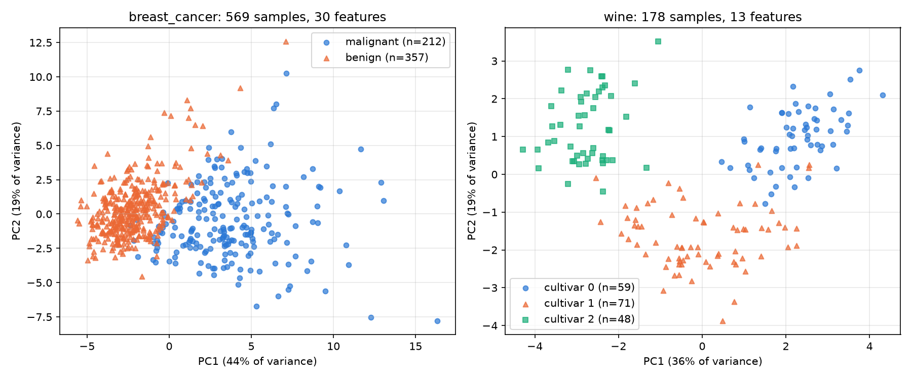
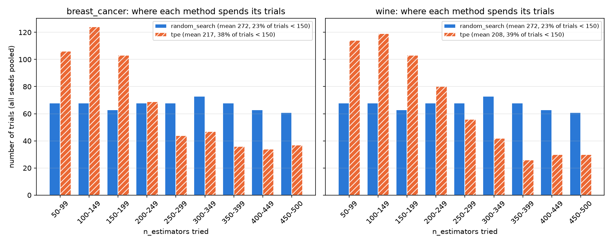

# Tối ưu siêu tham số cho Random Forest: Baseline, Random Search và TPE (Optuna)

> Bản tiếng Anh: [README.md](README.md). Đồ án môn *Nhập môn Tối ưu hóa*, Trường Đại học Văn Lang, Khoa Công nghệ thông tin, chuyên ngành Trí tuệ nhân tạo.

Đồ án so sánh công bằng ba cách chọn siêu tham số cho mô hình Random Forest trên hai bộ dữ liệu công khai, rồi kiểm tra xem phần cải thiện có giữ được trên dữ liệu chưa từng thấy hay không. Toàn bộ thí nghiệm chạy lại được bằng một lệnh: `python src/run_all.py`.

## 1. Dữ liệu nói về cái gì?

Cả hai dataset đều là **bảng số**: mỗi hàng là một mẫu, mỗi cột là một đặc trưng đo được, và có một nhãn cần dự đoán. Hãy hình dung bài toán "dự đoán khách hàng có rời bỏ hay không": mỗi hàng là một khách hàng, các cột là thông tin của họ, nhãn là "rời đi" hoặc "ở lại". Hai dataset của đồ án có cùng cấu trúc đó. Không có giá trị thiếu, và đều có sẵn trong thư viện scikit-learn.

| | `breast_cancer` (dataset chính) | `wine` (dataset phụ) |
|---|---|---|
| Mỗi hàng là | một khối u vú của một bệnh nhân | một chai rượu vang |
| Số mẫu | 569 | 178 |
| Các cột (đặc trưng) | 30 số đo từ ảnh tế bào được chọc hút bằng kim nhỏ: 10 đại lượng (bán kính, độ biến thiên xám, chu vi, diện tích, độ trơn, độ đặc, độ lõm, số điểm lõm, độ đối xứng, fractal dimension), mỗi đại lượng có 3 thống kê (trung bình, sai số chuẩn, giá trị tệ nhất) | 13 chỉ số hóa học: độ cồn, axit malic, tro, magiê, phenol, flavonoid, cường độ màu, proline... |
| Nhãn cần dự đoán | ác tính (212) hoặc lành tính (357) | thuộc 1 trong 3 giống nho (59 / 71 / 48) |
| Mục đích của dataset | học cách phân biệt khối u ác tính với lành tính | học cách nhận ra giống nho từ phân tích hóa học |

Dataset **không phải** là số ca bệnh hay doanh số rượu. Nó chỉ là dữ liệu mẫu để dạy một mô hình đoán nhãn. Đây cũng không phải công cụ chẩn đoán thật.

### Nhìn dữ liệu bằng hình

Hình dưới chiếu dữ liệu xuống 2 chiều bằng PCA (mỗi chấm là một mẫu, màu và hình dạng là nhãn thật).



- `breast_cancer`: hai lớp lệch nhau dọc theo trục PC1 nhưng có một **dải chồng lấn** ở giữa.
- `wine`: ba giống tạo thành ba cụm khá tách biệt, chỉ chạm nhau ở rìa.
- Hai trục chỉ giữ 63% (`breast_cancer`) và 55% (`wine`) lượng thông tin, nên hình chỉ để hình dung, không phản ánh hết khoảng cách thật giữa các lớp.

Điều này giải thích vì sao Random Forest **mặc định đã đạt điểm rất cao** (khoảng 0.955 trên `breast_cancer` và 0.983 trên `wine`): phần lớn mẫu nằm xa ranh giới nên dễ phân loại. Phần còn cải thiện được chủ yếu nằm ở dải chồng lấn. Đây là gốc của hiện tượng "chạm trần" ở phần kết quả.

## 2. Mô hình nào, và tối ưu cái gì?

Mô hình là **Random Forest**: nhiều cây quyết định bỏ phiếu với nhau để đoán nhãn. Bạn **không** tối ưu dữ liệu, cũng không tối ưu số ca bệnh. Bạn tối ưu **các "nút chỉnh" của mô hình**, gọi là **siêu tham số**.

### Biến tối ưu (biến quyết định) là gì?

Là **4 siêu tham số** của Random Forest:

| Biến | Nó điều khiển gì | Miền giá trị | Đặt quá thấp | Đặt quá cao |
|---|---|---|---|---|
| `n_estimators` | số cây bỏ phiếu | 50 đến 500 | kết quả kém ổn định | chậm hơn, từ một mức nào đó không tốt thêm |
| `max_depth` | mỗi cây được hỏi sâu tới đâu | 3 đến 30 | cây quá đơn giản, bỏ sót quy luật | cây học thuộc luôn nhiễu của dữ liệu train |
| `min_samples_split` | cần tối thiểu bao nhiêu mẫu mới được tách nhánh | 2 đến 20 | cây tách quá chi tiết, dễ học thuộc | cây quá thô |
| `max_features` | mỗi lần tách, cây được xem bao nhiêu cột | `sqrt`, `log2`, `None` | các cây yếu hơn | các cây giống nhau, bỏ phiếu kém hiệu quả |

### Vì sao tối ưu đúng các biến này?

Khi huấn luyện, mô hình tự học các thông số bên trong (ví dụ ngưỡng tách ở từng nút). Bốn biến trên thì khác: **không có thuật toán nào tự học chúng, người dùng phải đặt trước khi huấn luyện**. Cùng một dữ liệu nhưng đặt khác đi thì mô hình cho kết quả khác. Chúng là phần duy nhất bạn được quyền thay đổi để cải thiện mô hình, nên chúng là biến quyết định của bài toán.

### Tối ưu để làm gì?

1. **Để mô hình đoán đúng hơn trên dữ liệu mới.** Mục tiêu trực tiếp là cực đại hóa điểm macro-F1.
2. **Để thay việc chỉnh bằng cảm tính** ("thử 100 cây xem sao") bằng một quy trình tìm kiếm có ngân sách cố định và lặp lại được.
3. **Để biết cách tìm nào đáng dùng:** với cùng 60 lần thử, tìm ngẫu nhiên hay tìm có học (TPE) cho kết quả tốt hơn, nhanh hơn, ổn định hơn. Đây là câu hỏi chính của đồ án.

Dạng toán học:

| Thành phần | Nội dung |
|---|---|
| Biến quyết định x | (`n_estimators`, `max_depth`, `min_samples_split`, `max_features`) |
| Hàm mục tiêu f(x) | macro-F1 trung bình qua 5-fold cross-validation trên tập train (cực đại hóa) |
| Ràng buộc | x nằm trong miền ở trên; mỗi phương pháp được đánh giá đúng 60 cấu hình (30/60/100 ở phần sensitivity) |

## 3. Mỗi lần "tính f(x)" thực chất tính cái gì?

Ví dụ với bài toán khối u. Giả sử thuật toán đề xuất một bộ nút: 120 cây, sâu tối đa 10, `min_samples_split` = 5, `max_features` = `sqrt`. Đánh giá bộ nút đó gồm:

1. **Chia dữ liệu.** 569 khối u chia thành 455 khối u để học và tối ưu (80%) và 114 khối u **khóa lại** làm bài thi cuối. Phần 114 này không đụng tới trong lúc tìm kiếm.
2. **Chia 455 khối u thành 5 phần** (mỗi phần 91 khối u).
3. **Lặp 5 lần:** dựng mô hình với bộ nút đang thử, học trên 4 phần (364 khối u, có cả số đo lẫn nhãn thật), rồi dự đoán nhãn cho 91 khối u còn lại, tức những khối u nó **chưa từng thấy**.
4. **Chấm điểm:** so nhãn dự đoán với nhãn thật (mỗi khối u đã có kết quả sinh thiết) và tính điểm F1.
5. **Lấy trung bình 5 lần.** Số đó là f(x) của bộ nút này.

Vậy thứ được tính là **mức đúng của dự đoán "khối u này ác tính hay lành tính" do mô hình đưa ra, trên các khối u mô hình chưa từng thấy lúc học**. Một lần tính mất khoảng 2 đến 3 giây.

**Vì sao dùng macro-F1 thay vì accuracy thông thường?** Với lớp "ác tính", F1 kết hợp hai câu hỏi: trong các khối u mô hình báo ác tính, bao nhiêu cái thật sự ác tính (ít báo nhầm); và trong các khối u thật sự ác tính, mô hình bắt được bao nhiêu cái (ít bỏ sót). Có 63% khối u là lành tính, nên một mô hình đoán toàn "lành tính" vẫn đạt khoảng 63% accuracy. Macro-F1 tính F1 riêng cho từng lớp rồi lấy trung bình, coi các lớp quan trọng như nhau, nên bỏ sót khối u ác tính không bị che đi.

Sau khi chọn xong, bộ nút tốt nhất được thi **đúng một lần** trên 114 khối u đã khóa. Đó là con số trung thực về mức đúng trên dữ liệu mới, tách biệt với điểm dùng để chọn nút.

## 4. Vì sao dùng Random Search và TPE?

Ba phương pháp chỉ là ba cách vặn nút khác nhau, chạy trên cùng dữ liệu, cùng các fold và cùng số lần thử:

- **Baseline:** để nguyên cấu hình mặc định, không tìm kiếm.
- **Random Search:** thử ngẫu nhiên 60 cấu hình rồi giữ cấu hình tốt nhất.
- **TPE (Bayesian Optimization):** cũng thử 60 lần nhưng học từ các lần trước để thử thông minh hơn.

Lý do chọn:

1. **Hộp đen, không có đạo hàm.** Không viết được f(x) thành công thức, nên Gradient Descent hay Adam (cần gradient) và LP hay CVXPY (cần công thức tuyến tính hoặc lồi) không áp dụng được.
2. **Biến hỗn hợp.** Ba biến là số nguyên, một biến là phân loại. Lấy mẫu ngẫu nhiên và TPE xử lý trực tiếp loại không gian này.
3. **Mỗi lần đánh giá đắt, ngân sách nhỏ.** Không gian đầy đủ có 451 × 28 × 19 × 3 = 719.796 tổ hợp. Ngay cả lưới thưa 5 giá trị cho mỗi biến số cũng cần 5 × 5 × 5 × 3 = 375 lần, vượt xa 60, nên Grid Search bị loại.
4. **Cần một đối chứng đơn giản và một ứng viên thông minh.** Random Search là đối chứng chuẩn (Bergstra & Bengio, 2012). TPE (Bergstra và cộng sự, 2011) dồn ngân sách vào vùng hứa hẹn, với chi phí cập nhật rất nhỏ so với 2 đến 3 giây mỗi lần thử. Baseline cho biết việc tối ưu có đáng công hay không.

### TPE khác Random Search ở điểm nào?

Hình dưới đếm các giá trị `n_estimators` mà hai phương pháp đã thử (gộp 10 seed × 60 lần thử mỗi phương pháp).



Random Search thử gần đều khắp 50 đến 500. TPE dồn nhiều lần thử vào vùng rừng nhỏ: 38% số lần thử có dưới 150 cây (Random Search: 23%), trung bình 217 cây so với 272 trên `breast_cancer`. Đây là quan sát phù hợp với cơ chế của TPE chứ chưa chứng minh nhân quả: 10 lần thử đầu của TPE trong Optuna vẫn là ngẫu nhiên, sau đó nó dồn vào vùng cho điểm cao. Trên các dataset này, dường như rừng cỡ 100 đến 350 cây đã đủ tốt. (Dãy cấu hình của Random Search chỉ phụ thuộc seed nên hai biểu đồ bên trái và phải có cột Random Search giống hệt nhau.)

## 5. Kết quả

### Thiết kế thực nghiệm công bằng

- Cùng dữ liệu, cùng cách chia 80/20 (`random_state=42`), cùng các fold, cùng ngân sách 60 lần đánh giá.
- 10 seed (0 đến 9), báo cáo mean ± std, không chọn lần chạy tốt nhất.
- **Tập test bị khóa**, chỉ dùng một lần ở bước đánh giá cuối.
- Lưu toàn bộ lịch sử trial để vẽ đường hội tụ.

### Kết quả chính (10 seed)

**`breast_cancer`**

| Phương pháp | CV macro-F1 | Test accuracy | Thời gian tìm kiếm mỗi seed |
|---|---|---|---|
| Baseline (mặc định) | 0.9551 ± 0.0029 | 0.9544 ± 0.0035 | 0.9 s |
| Random Search | 0.9591 ± 0.0012 | 0.9561 ± 0.0000 | 171.9 s |
| TPE | **0.9606 ± 0.0014** | 0.9535 ± 0.0040 | 121.2 s |

**`wine`**

| Phương pháp | CV macro-F1 | Test accuracy | Thời gian tìm kiếm mỗi seed |
|---|---|---|---|
| Baseline (mặc định) | 0.9833 ± 0.0054 | 1.0000 | 0.8 s |
| Random Search | 0.9908 ± 0.0029 | 1.0000 | 130.8 s |
| TPE | 0.9914 ± 0.0041 | 1.0000 | 99.4 s |


### Sensitivity: ngân sách thay đổi thì sao? (`breast_cancer`, 3 seed)

| Ngân sách | Random Search | TPE |
|---|---|---|
| 30 lần thử | 0.9593 ± 0.0011 | 0.9608 ± 0.0011 |
| 60 lần thử | 0.9593 ± 0.0011 | 0.9608 ± 0.0011 |
| 100 lần thử | 0.9600 ± 0.0001 | 0.9609 ± 0.0011 |


### Điều rút ra

1. **Tối ưu cải thiện điểm CV, đều đặn nhưng khiêm tốn.** Trên `breast_cancer`, cả hai phương pháp thắng baseline ở cả 10 seed (kiểm định Wilcoxon cặp, p = 0.002). Trên `wine`, thắng ở 8 trên 10 seed (2 seed hòa).
2. **TPE so với Random Search: nhỉnh hơn ở một dataset, không khác ở dataset kia.** Trên `breast_cancer`, TPE hơn +0.0015 điểm F1 (8 thắng, 2 hòa, 0 thua, p = 0.008): có thật nhưng rất nhỏ. Trên `wine`, không khác biệt (6 hòa, p = 1.0).
3. **TPE rẻ hơn.** Do dùng rừng nhỏ hơn, một lần tìm 60 trial mất 121 giây so với 172 giây mỗi seed trên `breast_cancer` (giảm 29%), và 99 giây so với 131 giây trên `wine` (giảm 24%).
4. **Phần cải thiện không hiện ra trên tập test.** Trên `breast_cancer`, accuracy test là 0.954 / 0.956 / 0.954, chênh nhau tối đa một mẫu trên 114. Trên `wine`, mọi phương pháp đều đạt 1.000 trên 36 mẫu test. Hai dataset đều nhỏ và dễ (hiệu ứng "chạm trần"), và điểm CV của cấu hình được chọn còn hơi lạc quan vì nó là giá trị lớn nhất trong 60 cấu hình đã thử. Vì vậy mức tăng CV +0.004 đến +0.005 chưa được chứng minh là giữ được trên dữ liệu mới.
5. **Ngân sách (chỉ 3 seed, mang tính gợi ý).** TPE đã đạt khoảng 0.9608 với 30 lần thử và gần như đi ngang đến 100, còn Random Search cần 100 lần để đạt 0.9600. Với 3 seed, các chênh lệch nằm trong một độ lệch chuẩn nên chưa kết luận chắc được.
6. **Địa hình phẳng.** Cấu hình tốt nhất của các seed rất khác nhau (`n_estimators` từ 68 đến 483 trên `breast_cancer`) nhưng điểm gần như bằng nhau, và 19 trên 20 cấu hình chọn `max_features` là `sqrt` hoặc `log2`. Có một vùng tốt rộng chứ không có một điểm tối ưu duy nhất.

### Quyết định

- Nếu mỗi lần đánh giá đắt hoặc ngân sách nhỏ (khoảng 30 đến 60 lần thử), dùng **TPE**: điểm CV bằng hoặc nhỉnh hơn, tốn ít hơn khoảng 25 đến 30% tài nguyên.
- Nếu ngân sách dồi dào hoặc cần đơn giản, **Random Search** là lựa chọn ổn (trên `wine` không khác TPE).
- Với dữ liệu dễ như hai dataset này, tối ưu chỉ thêm tối đa nửa điểm CV và không đo được gì trên tập test, nên Random Forest mặc định đã là lựa chọn hợp lý.
- Vùng tìm kiếm gợi ý cho các dữ liệu này: `max_features` thuộc {`sqrt`, `log2`}, `n_estimators` khoảng 100 đến 350.

## 6. Giới hạn

- Cả hai dataset đều nhỏ và dễ với Random Forest, nên điểm gần chạm trần và khác biệt giữa các phương pháp nhỏ. Tập test chỉ có 114 và 36 mẫu: đổi nhãn một mẫu làm accuracy lệch khoảng 0.9 và 2.8 điểm phần trăm.
- Chỉ một họ mô hình (Random Forest), bốn siêu tham số và một hàm mục tiêu; chưa có tối ưu đa mục tiêu (ví dụ độ chính xác với độ trễ).
- Thời gian chạy đo trên một máy cá nhân. Phần sensitivity chỉ có 3 seed, và các giá trị p chưa được hiệu chỉnh cho nhiều phép so sánh.

## 7. Chạy lại

Cần Python 3.10 trở lên. Kết quả báo cáo được tạo bằng Python 3.14.0, scikit-learn 1.9.1, Optuna 5.0.0, NumPy 2.5.4 trên Windows 11.

```bash
git clone https://github.com/nguyndeeptry/rf-hyperparameter-optimization.git
cd rf-hyperparameter-optimization
python -m venv .venv
.venv\Scripts\activate
pip install -r requirements.txt

python src/run_all.py --quick
python src/demo.py
python src/run_all.py
```

`--quick` chạy thử trong vài phút, `demo.py` minh họa phần tối ưu trong 1 đến 2 phút, và `run_all.py` chạy lại toàn bộ (khoảng 2 đến 3 giờ, có thể chạy tiếp nếu bị ngắt). Mọi yếu tố ngẫu nhiên đều theo seed nên chạy lại cho đúng số liệu đã lưu khi dùng cùng phiên bản thư viện.

## 8. Cấu trúc thư mục

```
src/        mã nguồn (config, data, baseline, search_random, search_tpe, run_experiment, evaluate_test,
            analyze, paired_tests, run_sensitivity, analyze_sensitivity, compare_scalability, demo, run_all)
results/    lịch sử run/trial (JSON), bảng (CSV), hình (PNG), run_meta.json cho từng dataset
docs/       hình dùng trong README này (tạo bằng src/make_dataset_figures.py)
report/     báo cáo đầy đủ
```

## 9. Nguồn dữ liệu và tài liệu tham khảo

Hai dataset là benchmark công khai của UCI Machine Learning Repository, đi kèm sẵn trong scikit-learn (`load_breast_cancer`, `load_wine`), nên không có dữ liệu nào được đưa lên repo và không có vấn đề bản quyền hay riêng tư. Trích dẫn chính xác lấy bằng nút *Cite* trên trang UCI của từng dataset:

- Wolberg, W., Mangasarian, O., Street, N., & Street, W. *Breast Cancer Wisconsin (Diagnostic)*. UCI Machine Learning Repository. https://doi.org/10.24432/C5DW2B
- Aeberhard, S., & Forina, M. *Wine*. UCI Machine Learning Repository. https://doi.org/10.24432/C5PC7J
- Bergstra, J., Bardenet, R., Bengio, Y., & Kégl, B. (2011). Algorithms for hyper-parameter optimization. *NeurIPS*.
- Bergstra, J., & Bengio, Y. (2012). Random search for hyper-parameter optimization. *JMLR*, 13.
- Akiba, T., et al. (2019). Optuna: A next-generation hyperparameter optimization framework. *KDD*.
- Pedregosa, F., et al. (2011). Scikit-learn: Machine learning in Python. *JMLR*, 12.
- Breiman, L. (2001). Random forests. *Machine Learning*, 45(1).

Tác giả: Lại Trần Đình Nguyên, Trường Đại học Văn Lang, Khoa Công nghệ thông tin, 2026.
